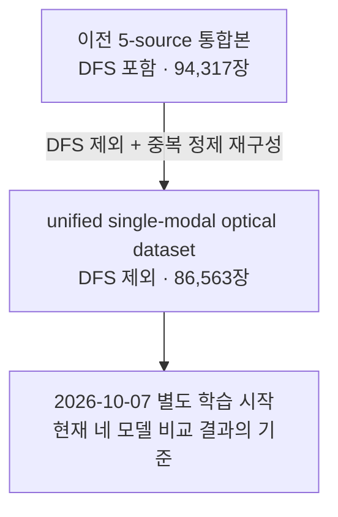
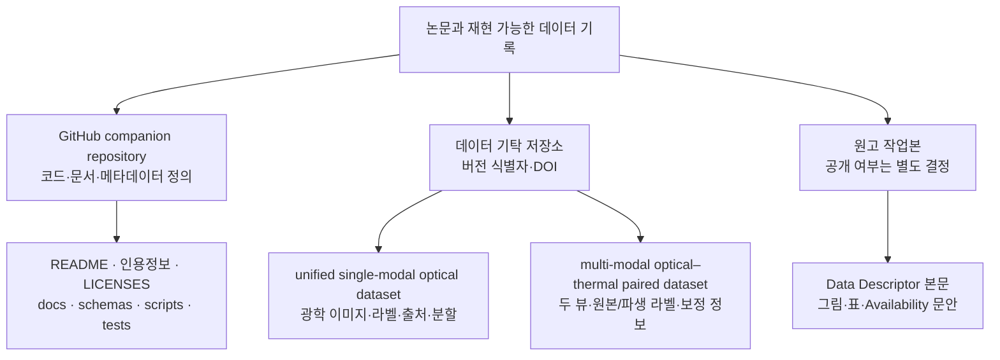

# 논문 작성을 위한 데이터·폴더·파일 구성 가이드

작성일: 2026-10-30 / 대상: Scientific Data의 Data Descriptor 준비

이 문서는 현재 준비 폴더를 논문 작성과 향후 데이터 공개에 어떻게 연결할지 정리한 작업 가이드입니다.
폴더명은 이 프로젝트의 제안이며 저널이 지정한 규격은 아닙니다.
**GitHub 비공개 저장소 [kmg-hi/unified-fire-smoke-datasets](https://github.com/kmg-hi/unified-fire-smoke-datasets)를 생성했습니다. 파일 업로드는 진행 중이며, 데이터의 공개 배포·최종 라이선스 확정은 하지 않았습니다.**

데이터와 학습 이력은 2026-10-30에 확인한 기록을 기준으로 합니다. 이 문서 작성 과정에서
원본 수정, 분할 재생성, 재학습 또는 test 재평가는 수행하지 않습니다.

## 1. 논문에서 구분할 두 데이터 기록

2026-11-04 표시명 변경: 아래 이름을 논문과 배포 안내에 사용합니다. 기존 Public Optical과
Paired RGB-T는 과거 기록의 별칭입니다. 배포 최상위 폴더명은 각각 `public optical/`과
`paired_RGBT/`이며, 고정 데이터 식별자 `public_optical_release_v1`과 `paired_rgbt_v1`은 유지합니다.

| 구분 | unified single-modal optical dataset | multi-modal optical–thermal paired dataset |
|---|---|---|
| 의미 | 공개 광학 데이터의 single-modal unified collection | 실제·합성 실험의 optical-thermal paired collection |
| 표본 단위 | RGB 이미지 1장 | 광학·열영상 1쌍 |
| 전체 규모 | 86,563장 | 35,859쌍, 71,718개 뷰 |
| 구성 | FASDD_CV·D-Fire·CQU·Roboflow | 실제 15,238쌍 + Unity 합성 20,621쌍 |
| Train / Val / Test | 68,475 / 8,714 / 9,374장 | 28,811 / 3,524 / 3,524쌍 |
| 분할 그룹 | 파일명 기반 시퀀스 그룹 5,845개 | domain+experiment 그룹 87개 |
| 관련 실험 | Faster R-CNN·RetinaNet·RT-DETR-L·YOLOv9-C | Optic-only·Thermal-only·RGB-T fusion |

Paired RGB-T의 optic-only와 thermal-only는 **같은 paired 표본·분할·공통 타깃에서 입력 뷰만
달리한 실험**입니다. Public Optical v1과 동일한 학습 데이터라는 뜻은 아닙니다.
두 데이터 기록의 성능 차이만으로 멀티모달 융합의 인과적 효과를 주장하지 않습니다.

세부 정의: [Public Optical 카드](dataset_cards/public_optical.md),
[Paired RGB-T 카드](dataset_cards/paired_rgbt.md), [데이터 사전](docs/data_dictionary.md).

## 2. DFS 제외와 실제 학습 버전



- DFS는 당시 명시적인 재배포 라이선스를 확인하지 못해 제외했습니다. 저작권 침해가 확정됐다는 의미는 아닙니다.
- DFS와 D-Fire는 서로 다른 데이터셋입니다. D-Fire는 현재 4-source 버전에 남아 있습니다.
- 86,563장은 이전 통합본에서 DFS만 산술적으로 뺀 결과가 아니라 정제·중복 보존 기준을 재구성한 별도 버전입니다.
- 현재 네 모델의 학습 설정은 모두 이 4-source 버전을 참조합니다.
- 2026-10-29 작업은 기존 최종 가중치로 클래스별 test 결과를 확장한 것으로, 재학습이 아닙니다.

### 논문에 적을 실제 학습 에포크

| 모델 | 최대 설정 | 실제 완료 | 종료 방식 |
|---|---:|---:|---|
| Faster R-CNN R50-FPN V2 | 100 | 100 | 설정 에포크 완료 |
| RetinaNet R50-FPN V2 | 100 | 100 | 설정 에포크 완료 |
| RT-DETR-L | 100 | 81 | 검증 성능 개선 없음 20회로 정상 조기 종료, best epoch 61 |
| YOLOv9-C | 100 | 90 | 검증 성능 개선 없음 20회로 정상 조기 종료, best epoch 70 |

공통 설정은 batch 16, 입력 크기 640, seed 20260924입니다.
**모두 100에포크 학습했다고 쓰지 않습니다.** 최대 예산과 실제 수행량을 구분합니다.
조기 종료된 두 모델은 학습 실패나 미완료가 아니며, 이를 이유로 학습을 다시 실행하지 않습니다.

현재 D-Fire의 `PublicDataset` 명칭 일치 719개는 권한 검토 대상으로 남아 있습니다.
현재 비교 모델은 이 719개를 추가 제외한 버전으로 학습된 것이 아닙니다.
DFS 제외만으로 나머지 이미지의 공개 권한까지 모두 확정된 것은 아닙니다.

## 3. 공개 구성의 전체 관계



두 데이터 기록을 별도 버전으로 관리하고 코드 릴리스와 연결하는 방향을 권장합니다.
하나의 논문에서 두 기록을 함께 설명할지, 별도 논문으로 나눌지는 연구 범위와 편집 적합성을
검토한 뒤 결정합니다. 이 구조만으로 저널 적합성이나 게재가 보장되지는 않습니다.

## 4. 현재 준비 폴더의 주요 구성

다음은 **실제로 작성된 주요 파일**입니다. 일부 하위 파일은 생략했습니다.

```text
scientific_data_publication/
|-- README.md
|-- PAPER_FILE_STRUCTURE_GUIDE.md
|-- PREPUBLICATION_CHECKLIST.md
|-- PREPARATION_REPORT.md
|-- CHANGELOG.md
|-- .gitignore
|-- LICENSES/
|   `-- README.md
|-- dataset_cards/
|   |-- public_optical.md
|   `-- paired_rgbt.md
|-- docs/
|   |-- scientific_data_policy_review.md
|   |-- repository_and_deposit_layout.md
|   |-- data_dictionary.md
|   |-- methods_and_validation.md
|   |-- rights_ethics_and_assets.md
|   `-- reproduction_and_release.md
|-- metadata/
|   |-- release_plan.json
|   |-- publication_status.json
|   |-- source_rights_review.csv
|   |-- code_provenance_inventory.csv
|   `-- dataset_overview.csv
|-- manuscript/
|   |-- data_descriptor_outline.md
|   |-- data_availability.template.md
|   |-- code_availability.template.md
|   `-- figures/README.md
|-- templates/
|   |-- CITATION.cff.template
|   |-- authors.template.json
|   |-- zenodo-software.json.template
|   |-- zenodo-public-optical.json.template
|   |-- zenodo-paired-rgbt.json.template
|   |-- acquisition_metadata.json.template
|   |-- annotation_provenance.csv.template
|   |-- unity_asset_rights.csv.template
|   |-- privacy_review.csv.template
|   `-- archive_inventory.csv.template
|-- schemas/
|   |-- public_optical_release_v1.schema.json
|   `-- paired_rgbt_v1.schema.json
|-- scripts/
|   |-- publication.py
|   |-- prepare_metadata.py
|   |-- validate_release.py
|   |-- make_checksums.py
|   `-- package_deposit.py
|-- tests/
|   `-- test_publication.py
|-- data_deposit/                 # Git 제외, 현재 메타데이터 준비본
`-- .local/                       # Git 제외, 개인 경로·검사 기록
```

`src/`는 현재 생성된 폴더가 아닙니다. 원래의 정제·분할·보정·주석 처리 코드를 공개 가능한
형태로 이식할 때 추가할 **예정 폴더**입니다. 현재 `scripts/`의 출판 준비 도구만으로 원래의
데이터 구축 전체 과정을 재현할 수 있다고 주장하지 않습니다.

## 5. 파일별 역할과 작성 기준

| 파일·폴더 | 담을 내용 | 주의사항 |
|---|---|---|
| `README.md` | 데이터 정체성, 접근 경로, 주요 문서 안내 | 아직 존재하지 않는 다운로드·DOI를 공개 링크처럼 기재하지 않음 |
| `dataset_cards/` | 단위·규모·출처·분할·타깃·한계 | 이미지 수와 쌍 수를 구분 |
| `docs/data_dictionary.md` | 필드 의미, 경로 기준, 클래스 ID, 해시 의미 | 원본 라벨과 학습용 파생 라벨 해시를 구분 |
| `docs/methods_and_validation.md` | 실제 수행한 구축 과정과 검증 근거 | 계획이나 미수행 검사를 완료된 방법으로 쓰지 않음 |
| `metadata/source_rights_review.csv` | 출처별 권한 검토 상태·근거·후속 조치 | 기존 라이선스 기록과 현재 공개 승인 여부는 별개 |
| `metadata/code_provenance_inventory.csv` | 원래 처리 코드의 파일명·해시·공개 이식 상태 | 목록만 있다고 재현 코드 공개가 완료된 것은 아님 |
| `metadata/publication_status.json` | 미해결 항목과 공개 준비 상태 | 근거 없이 승인·완료로 바꾸지 않음 |
| `LICENSES/` | 최종 선택한 코드·데이터 라이선스와 출처별 예외 | 현재는 안내문만 있으며 일괄 라이선스를 부여하지 않음 |
| `manuscript/` | 본문 구조, Availability 초안, 그림 계획 | 원고 초안의 GitHub 공개는 별도 승인 필요 |
| `templates/` | 저자·촬영·주석·권한·기탁 정보 입력 틀 | 빈 템플릿을 최종 제출 메타데이터로 사용하지 않음 |
| `schemas/` | 공개 manifest의 허용 필드·형식 | 개인 PC·원격 운영 경로를 넣지 않음 |
| `scripts/`, `tests/` | 메타데이터 정리와 무결성·배포 전 검사 | 실제 이미지 품질·윤리 검토를 대체하지 않음 |
| `CHANGELOG.md` | 버전별 파일·표본·주석 변경 이력 | 동결 데이터의 조용한 교체 금지 |

저자와 기관의 검토 후 `CITATION.cff.template`을 완성해 최종 인용 파일로 전환합니다.
저자·ORCID·DOI·라이선스를 임의로 채우지 않습니다.

## 6. 데이터 기탁 준비 폴더

현재 두 폴더에는 **manifest·분할 목록·설명·메타데이터 체크섬**이 생성돼 있습니다.
아래 `[미기탁]`은 공개 영구 저장소 기탁이 완료되지 않았다는 뜻입니다.
2026-11-04 저자 승인에 따른 별도 비공개 ZIP 전송은 진행 중이며,
해당 원본 이미지·원본/학습용 라벨은 파일별·압축 복원·전송 해시를 구분해 검증합니다.

### 6.1 unified single-modal optical dataset

```text
data_deposit/public optical/
|-- README.md
|-- metadata/
|   |-- manifest.csv
|   |-- classes.json
|   |-- source_registry.csv
|   |-- license_provenance_recorded.csv
|   |-- source_rights_review.csv
|   |-- rights_review_queue.csv
|   |-- source_split_summary.json
|   |-- source_deduplication_config.json
|   |-- summary.json
|   `-- build_provenance.json
|-- splits/{train,val,test}.txt
|-- SHA256SUMS_METADATA.txt
|-- images/{train,val,test}/...              [미기탁]
|-- labels/{train,val,test}/...              [미기탁]
`-- annotations/instances_{split}.json       [미기탁, 기존 COCO 산출물 검증 후 포함]
```

`rights_review_queue.csv`는 현재 식별된 D-Fire 719개 검토 목록입니다.
목록 밖의 이미지가 모두 권한 검토를 통과했다는 의미는 아닙니다.

### 6.2 multi-modal optical–thermal paired dataset

```text
data_deposit/paired_RGBT/
|-- README.md
|-- metadata/
|   |-- manifest.csv
|   |-- classes.json
|   |-- registration.public.json
|   |-- source_summary.json
|   |-- source_validation_recorded.json
|   |-- source_rights_review.csv
|   |-- summary.json
|   `-- build_provenance.json
|-- splits/{train,val,test}.txt
|-- SHA256SUMS_METADATA.txt
|-- dataset/{real,synthetic}/{experiment}/   [미기탁]
|   |-- pair_optic/...
|   |-- pair_thermal/...
|   `-- pair_label/...
`-- labels/{optic,thermal}/{domain}/{experiment}/... [미기탁]
```

| 경로·필드 | 의미 |
|---|---|
| `pair_optic/` | 실제 사용한 광학 뷰 |
| `pair_thermal/` | 실제 사용한 처리·보정 열영상 뷰, 원시 온도 데이터로 간주하지 않음 |
| `pair_label/`, `source_label_sha256` | 원본 주석과 해당 바이트의 해시 |
| `labels/{optic,thermal}/`, `training_label_sha256` | 실제 학습에 사용한 동결 파생 타깃과 그 해시 |

기존 메타데이터 준비본의 `training_label_sha256`는 비어 있습니다. 별도 비공개 전송본은
보존된 학습 기록의 원래 라벨 바이트와 해시를 확인해 이 필드를 채웁니다.
실제 동결 학습 라벨에서 확보해야 하며,
원본 주석 해시를 복사해 채우거나 라벨을 새로 생성·보정해서 대신하지 않습니다.

`SHA256SUMS_METADATA.txt`는 현재 **메타데이터만** 검증합니다. 전체 데이터 기탁 시에는
실제 이미지·라벨·압축 파일의 해시와 멤버 목록도 검증·제공해야 합니다.

## 7. 논문 섹션과 파일의 연결

| 논문 섹션 | 참고 파일·작성 근거 |
|---|---|
| Title / Abstract | `dataset_cards/`, 두 기록의 단위·범위·한계 |
| Background & Summary | 원출처 인용, 통합·정제 목적, 기존 발표와의 차이 |
| Methods | `docs/methods_and_validation.md`, 정제 설정, 촬영·주석·보정 근거 |
| Data Records | 이 문서 6절의 실제 파일 구조, `docs/data_dictionary.md`, 확정된 기탁 버전·접근 링크 |
| Data Overview, 선택 | `metadata/dataset_overview.csv` 기반의 간결한 규모·분할 표 |
| Technical Validation | 실제 무결성·주석·정합 검증과 범위가 명확한 기존 held-out 기준 성능 |
| Usage Notes | modality/domain 구분, 원본/파생 GT, 부재 클래스와 잔여 시차 등 한계 |
| Data Availability | `manuscript/data_availability.template.md`, 최종 데이터 기록 식별자 |
| Code Availability | `manuscript/code_availability.template.md`, 실제 공개 코드 버전·환경 |
| Author Contributions / Funding / Competing Interests / Ethics | 저자와 기관의 실제 확인 자료 |

본문 시작점은 [Data Descriptor 개요](manuscript/data_descriptor_outline.md)입니다.
Data Records는 파일을 찾아 해석할 수 있게 쓰고, 통계·모델 순위 나열로 대신하지 않습니다.
기준 모델은 기술적 검증의 보조 근거로 다루며 일반적인 알고리즘 성능 경쟁 논문처럼 구성하지 않습니다.

### 그림과 표의 초안

| 후보 | 목적 | 준비 상태 |
|---|---|---|
| 데이터 구축 흐름도 | 원출처·수집·정제·분할·최종 기록의 관계 | 이 문서의 도식을 기반으로 원고용 정리 필요 |
| 대표 광학·열영상 쌍 | 두 뷰와 공통 타깃의 의미 | 권한·개인정보 검토 후 표본 선정 필요 |
| 데이터 구성·분할 표 | 두 기록과 실제/합성 비율 설명 | `dataset_overview.csv` 존재 |
| 출처·라이선스 표 | 입력 버전·인용·가공·권한 조건 설명 | 기록 존재, 공개 권한 검토 미완료 |
| 품질 검증 표·그림 | 실제 수행한 무결성·주석·정합 검증 설명 | 기존 증거와 미수행 검사를 구분해 보완 필요 |

그림과 표의 개수·채택 여부는 최종 원고 범위에 따라 결정합니다.
이 목록은 실험이나 통계를 새로 수행했다는 뜻이 아닙니다.

## 8. 반드시 유지할 해석상의 한계

- 실제 test 1,524쌍에는 Fire 2,264개, Smoke 0개의 정답 상자가 있습니다.
- 전체 실제 데이터에는 Smoke 주석이 있지만, 실제 Smoke의 held-out test 성능은 입증할 수 없습니다.
- 합성 test 2,000쌍에는 Fire 3,738개, Smoke 2,298개의 정답 상자가 있습니다.
- 합성 주석은 모델 보조 생성 이력이 있어 완전히 독립적인 수동 GT라고 표현하지 않습니다.
- 분할은 experiment-disjoint이며 scene-disjoint라고 주장하지 않습니다.
- Unity 열영상 정합은 기준 깊이 평면에서 유효하며, 다른 깊이에는 잔여 시차가 있습니다.
- 두 데이터 기록 사이의 교차 중복은 아직 별도로 검증하지 않았습니다.
- 모델 용량·손실·증강·최적화·정밀도·P/R 운영점이 달라 완전 통제된 비교로 해석하지 않습니다.
- 기존 비교의 All은 클래스 평균이며, 도메인별 값의 단순 평균이나 class-agnostic 평가가 아닙니다.
- ICAFusion을 비교 보고서에서 제외하는 것과 데이터 표본이나 완료된 산출물을 삭제하는 것은 별개입니다.

## 9. GitHub 공개 전 파일 선별

| 범위 | 처리 방향 |
|---|---|
| 검토 완료된 설명·사전·스키마·재현 코드·테스트 | companion repository 공개 후보 |
| `.local/`, 개인 PC 경로·인증 정보·내부 운영 기록 | 공개하지 않음 |
| `data_deposit/`, `archives/`, 대용량 이미지·영상·가중치 | 현재 Git 제외, 권한 검토 후 적절한 별도 기록에서 관리 |
| `manuscript/`, 저자 입력 틀에 채운 개인정보·미발표 초안 | 저자 승인 후 공개 여부를 별도 결정 |
| 기관 검토·동의·권리 증빙 원본 | 공개 허용 범위를 확인하고 필요한 공개 설명만 분리 |

현재 `.gitignore`가 `manuscript/` 전체를 자동으로 제외하지는 않습니다.
향후 처음 커밋할 때 원고 초안을 포함할지 반드시 확인해야 하며, 상위 연구 폴더 전체를 저장소로 만들지 않습니다.
이미지 예시도 공개 허가를 확인한 뒤 선택합니다.

## 10. 권장 작성 순서

1. 두 데이터 기록의 범위와 논문 한 편/두 편의 구성을 저자들과 결정합니다.
2. 데이터 카드와 Methods를 확인된 사실로 채우고, 모르는 항목은 미확정으로 남깁니다.
3. 출처별 권한·실촬영 윤리/개인정보·Unity 자산 권한을 검토합니다.
4. 실제 동결 이미지와 원본/파생 라벨을 확보해 기탁 파일과 manifest를 대조합니다.
5. 원래 처리 코드의 공개 이식과 환경 고정, 재현성 검사를 완료합니다.
6. 실제 기탁 구조를 기준으로 Data Records·데이터 사전·그림 설명을 완성합니다.
7. 확인된 검증 근거로 Technical Validation을 작성하고 실제 학습 에포크와 평가 정의를 명시합니다.
8. 저자·라이선스·저장소·식별자가 확정되면 인용 파일과 Availability 문안을 완성합니다.
9. 공개 전 검사와 저자 승인을 마친 뒤 저장소 생성·기탁·업로드 절차로 넘어갑니다.

저장소 생성 방법과 업로드 명령은 이 문서의 실행 범위에 포함하지 않습니다.
현재 비공개 저장소 `kmg-hi/unified-fire-smoke-datasets`는 생성되어 있으며,
문서·메타데이터와 실제 데이터 ZIP의 비공개 전송이 진행 중입니다.
이는 공개 데이터 기탁·DOI 발급·재배포 권한 검토 완료를 뜻하지 않습니다.

## 11. 관련 문서와 공식 근거

- [현재 준비 결과](PREPARATION_REPORT.md)
- [공개 전 체크리스트](PREPUBLICATION_CHECKLIST.md)
- [정책 검토와 공식 링크](docs/scientific_data_policy_review.md)
- [기탁 구조 상세](docs/repository_and_deposit_layout.md)
- [현재 도구의 실행·검사 범위](docs/reproduction_and_release.md)
- [Scientific Data 제출 지침](https://www.nature.com/sdata/submission-guidelines)
- [Scientific Data 저장소 정책](https://www.nature.com/sdata/policies/repositories)
- [Scientific Data 코드 공개 정책](https://www.nature.com/sdata/policies/editorial-and-publishing-policies)

정책 링크는 2026-10-30에 검토한 준비 문서를 따릅니다. 실제 제출 직전에 다시 확인합니다.
**이 가이드는 논문 작성과 공개 준비를 위한 구조 문서이며, 재배포 권한이나 저널 게재를 보증하지 않습니다.**
