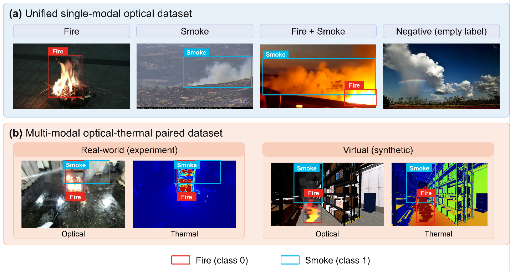

# UniFSD: Unified fire and smoke dataset

**UniFSD** stands for **Unified Fire and Smoke Dataset**. It is the umbrella
name for the two separate records below; the name does not merge their sample
membership, change the frozen splits or rename their manifest identifiers.

Two curated records for optical and optical-thermal fire/smoke detection.
The repository contains documentation, metadata, frozen split assignments and
read-only validation tools. Images and labels are distributed as separate ZIP
attachments, not ordinary Git files.

Companion to the manuscript *Unified single- and multi-modal fire and smoke
datasets with optical and thermal images for vision research* by Min-Gwan Kim
and Ki-Yong Oh, Hanyang University. The documentation and
[manuscript figure gallery](figures/manuscript_v2/README.md) were updated against
the supplied v2 manuscript on 13 November 2026. The manuscript file itself is not
distributed in this repository.

**Status:** author-approved private distribution. The repository and dataset
drafts remain private. Public redistribution rights, final licences, author
information and dataset DOIs are still under review.

The Zenodo draft identifiers supplied for the optical and paired records are
`10.5281/zenodo.24182273` and `10.5281/zenodo.24182393`, respectively. Their public
availability was not independently verified for this documentation update;
reserved identifiers are not evidence of publication.

## Datasets

| Record | Root folder | Train | Validation | Test | Total |
|---|---|---:|---:|---:|---:|
| unified single-modal optical dataset | `public optical/` | 68,475 | 8,714 | 9,374 | 86,563 images |
| multi-modal optical–thermal paired dataset | `paired_RGBT/` | 28,811 | 3,524 | 3,524 | 35,859 pairs |

The stable identifiers are `public_optical_release_v1` and `paired_rgbt_v1`.
Folder names are case-sensitive; `public optical` contains a space.

The optical record retains FASDD_CV 66,480 images, D-Fire 6,288, CQU 6,244 and
Roboflow_FireSmoke 7,551. DFS is excluded. It contains 112,279 boxes:
67,269 Fire and 45,010 Smoke. Its 41,364 zero-box images have empty labels;
these are annotation-negative samples, not independently verified absence of
every possible fire or smoke phenomenon.

The paired record contains 15,238 real and 20,621 Unity-synthetic pairs,
or 71,718 image views, from 66 real and 21 synthetic experiments.
Each pair preserves optical/thermal correspondence. Optic-only and thermal-only
experiments on this record use the same pair membership and targets.
They are **not** the separate 86,563-image optical record.



Representative annotations are shown above. Empty labels mean no annotated
objects, not independently verified absence of every fire or smoke phenomenon.
Thermal views are processed colour images rather than calibrated temperature
measurements.

## Download

| Data | Private download | ZIP parts |
|---|---|---:|
| Optical | [Dataset attachments](https://github.com/kmg-hi/UniFSD/releases/tag/untagged-83bf651c3c7c7f34d35b) | 8 |
| Optical-thermal | [Dataset attachments](https://github.com/kmg-hi/UniFSD/releases/tag/untagged-d38a0decc3241fd55fa6) | 17 |

1. Download every ZIP named in the dataset's `*-archives.json` catalog.
2. Use the revised first part containing `metadata20261109`; do not mix it with
   the superseded first part.
3. Extract all parts into one **new empty parent directory**. Do not concatenate
   ZIPs. Extracting over an older directory does not remove obsolete files.
4. Resolve manifest paths relative to the appropriate dataset root.

The catalog records ZIP sizes and SHA-256. `PAYLOAD_FILES.csv` records the
retained image/annotation file paths, sizes and hashes. Manifests retain their
hash fields. Standalone checksum-list files and the registration JSON are not
included in the current distribution.

The full image/label tree appears only after ZIP extraction. GitHub's
**Code > Download ZIP** does not contain the dataset images or labels.

## Layout and Annotations

```text
public optical/
  images/{train,val,test}/
  labels/{train,val,test}/
  metadata/
  splits/{train,val,test}.txt
  PAYLOAD_FILES.csv

paired_RGBT/
  dataset/{real,synthetic}/{experiment}/
    pair_optic/
    pair_thermal/
    pair_label/
  labels/{optic,thermal}/{real,synthetic}/{experiment}/
  metadata/
  splits/{train,val,test}.txt
  PAYLOAD_FILES.csv
```

YOLO training labels use `class_id x_center y_center width height`, with
normalised coordinates and `0=fire`, `1=smoke`.
An empty label file contains zero annotated objects.

In the paired record, `pair_label/` preserves original source rectangles.
`labels/{optic,thermal}/` contains the actual frozen common derived training
targets. Source and training annotations may differ due to boundary clipping;
do not substitute them. Their hashes are recorded separately as
`source_label_sha256` and `training_label_sha256`.

Each split file lists stable sample identifiers, one per line, rather than
image paths. Preserve these frozen assignments for benchmark reproduction.

## Documentation and Figures

- [Current manuscript figures 1-10 and interpretation notes](figures/manuscript_v2/README.md)
- [Completed held-out test benchmarks and evaluation conventions](docs/benchmarks.md)
- [Folder structure and metadata](docs/DATASET_STRUCTURE_AND_METADATA.md)
- [Manifest field definitions](docs/data_dictionary.md)
- [Curation methods and limitations](docs/methods_and_validation.md)
- [Download, validation and figure reproduction](docs/usage_and_validation.md)
- [Reproducible overview statistics and earlier figure designs](figures/data_overview/README.md)
- [Current manuscript directory illustration](figures/manuscript_v2/Figure06.png)

**Path convention:** manuscript Figure 6 displays `public_optical/` as its optical
root label. The actual archive root is `public optical/` with a space. The paired
archive root is exactly `paired_RGBT/`. Do not rename the extracted roots to match
a schematic label. File inventories and manifests are authoritative.

`schemas/` defines manifest fields; `scripts/` and `tests/` provide
read-only checks and descriptive figure generation. `metadata/` retains source,
version and rights-review records. It is not evidence that publication approval
has been granted.

## Validation

Python 3.10 or later is sufficient for metadata validation; no third-party
packages are needed for these commands:

```bash
python -B -m unittest discover -s tests -v
python -B scripts/validate_release.py --mode metadata
```

After extracting the payload, `--verify-files` also checks every image/label
against the manifest hash. See the usage guide for dataset locations and
optional plotting dependencies.

These utilities are not a complete portable reproduction of the original
capture, curation, registration or annotation-generation pipeline.
No training or model evaluation runs as part of validation.

## Limitations

- Filename-group or experiment-group separation does not establish independent
  scenes or exhaustive semantic deduplication. Cross-record overlap has not been
  jointly audited.
- Paired thermal views are processed/registered colour images, not calibrated
  temperature measurements. Reference-plane registration retains parallax at
  other depths; removing the distribution configuration does not undo processing.
- Synthetic annotations were model assisted; they are not wholly independent
  manually drawn ground truth.
- Real held-out paired test data contain Fire 2,264 / Smoke **0** source boxes.
  Synthetic test data contain Fire 3,738 / Smoke 2,298. Real-Smoke test
  generalisation cannot be inferred.
- The optical record's test labels contain Fire 5,485 / Smoke 4,307 boxes.
  Do not merge its test with the paired record's optic-only benchmark.

## Attribution, Licensing and Citation

Final data/code licences and dataset DOIs are pending.
See [licensing notes](LICENSES/README.md), the source registry and the
source-rights records in each dataset's metadata directory. Public availability
of an input collection is not itself redistribution permission.
No blanket licence is granted by this preparation repository.

Cite the exact dataset version, its original component sources and the
accompanying article when final identifiers are available. No placeholder DOI,
author list or contact address is presented as final.

Version changes are recorded in [CHANGELOG.md](CHANGELOG.md).
