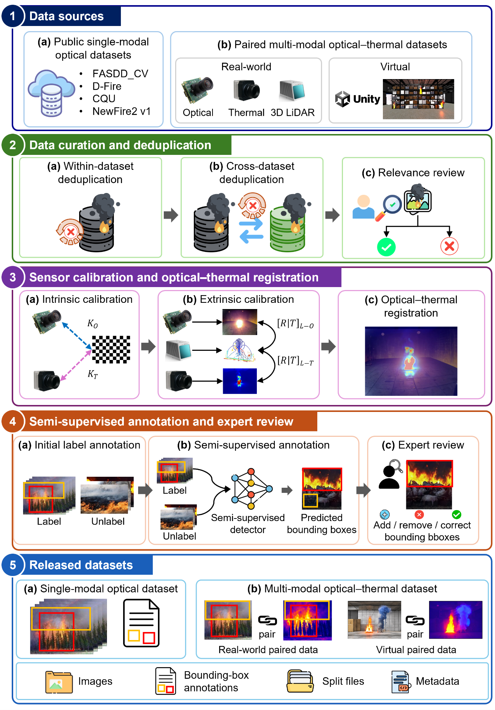
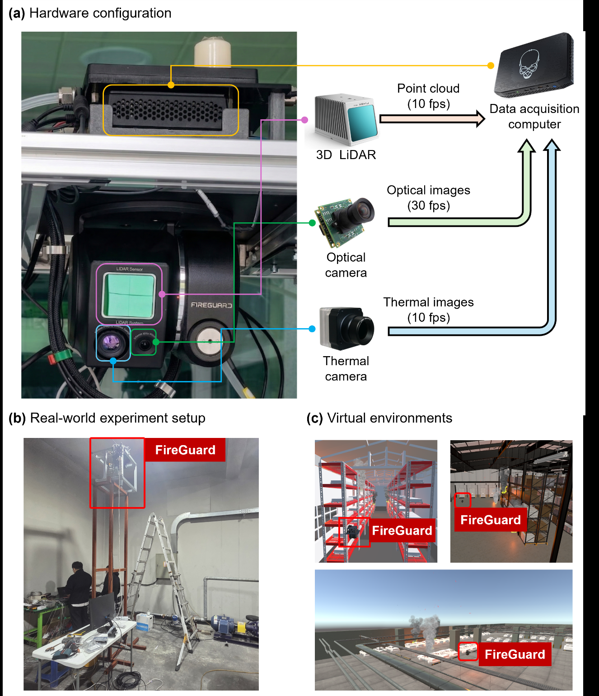
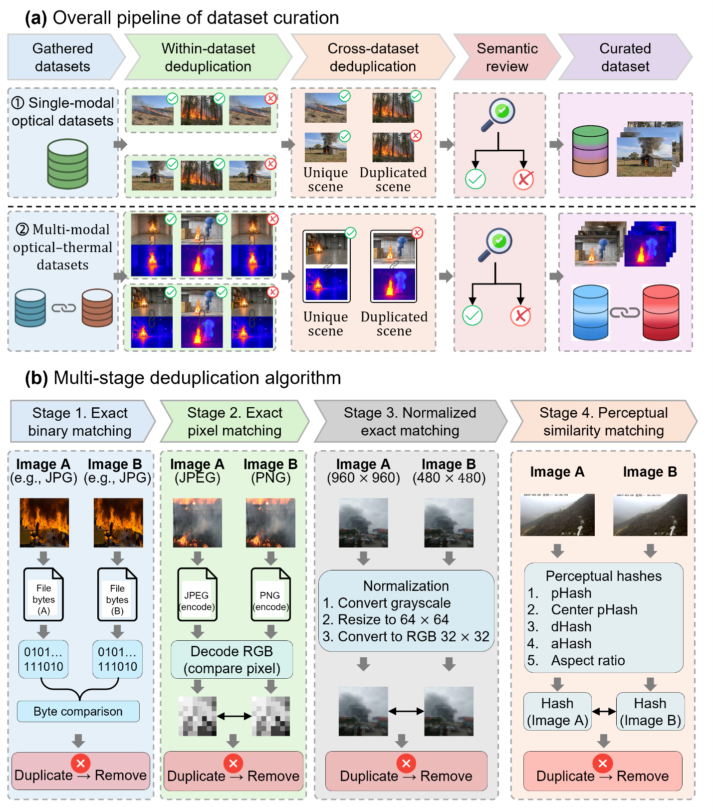
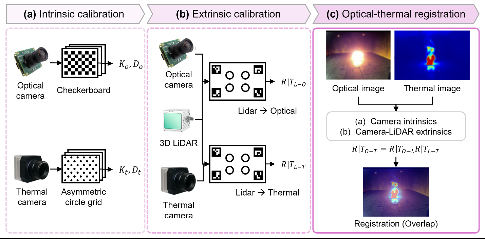
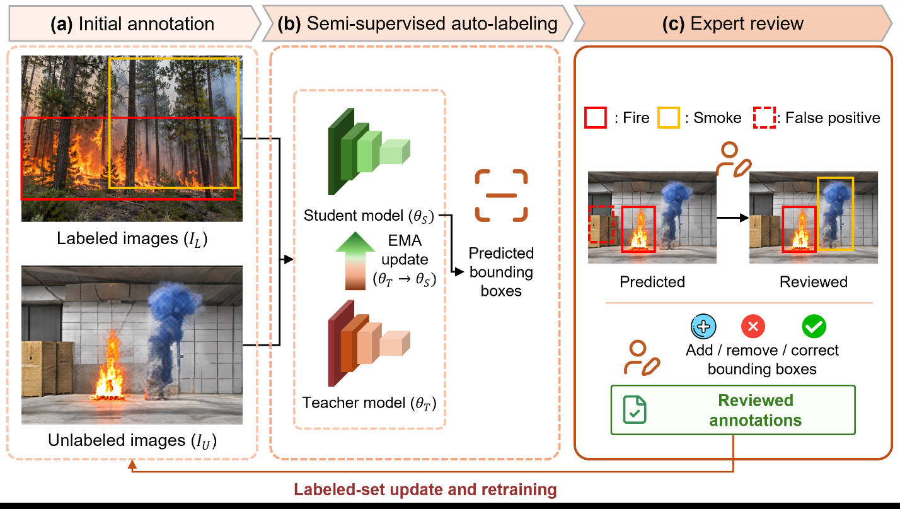
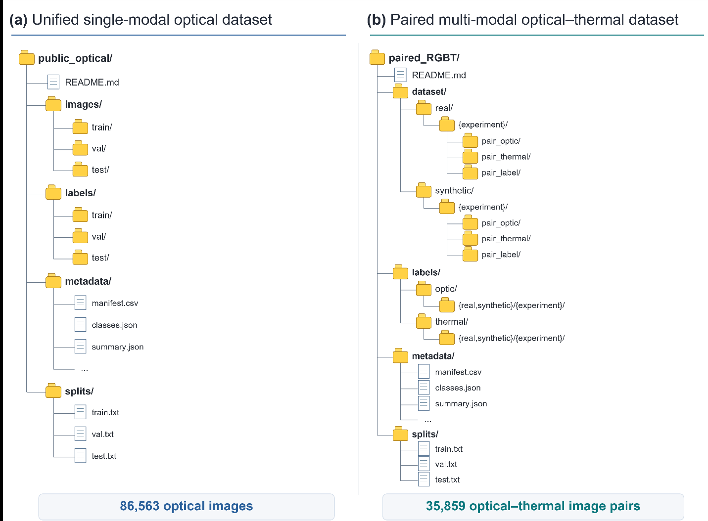
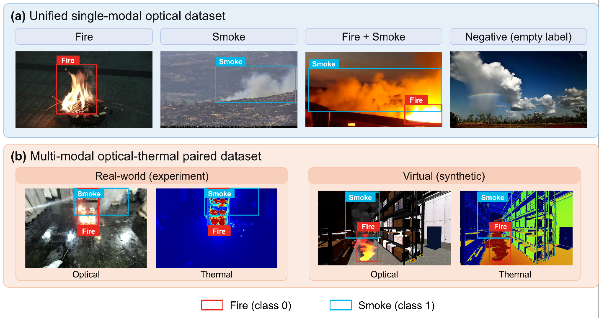
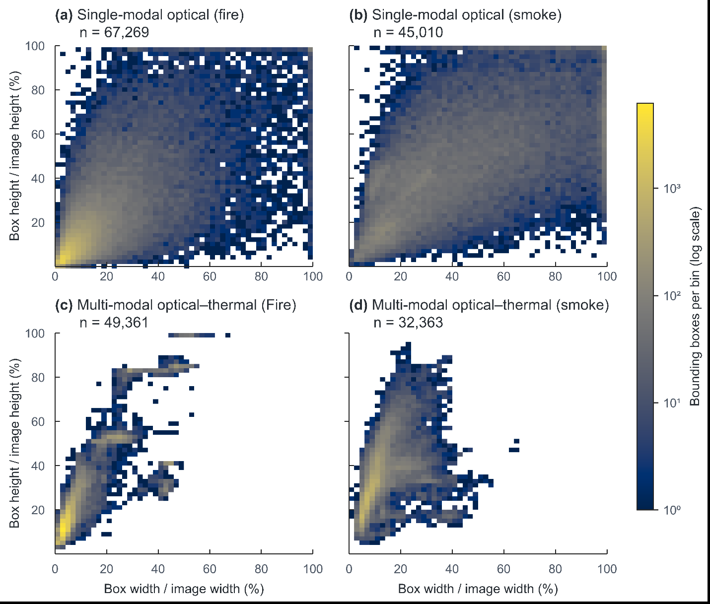
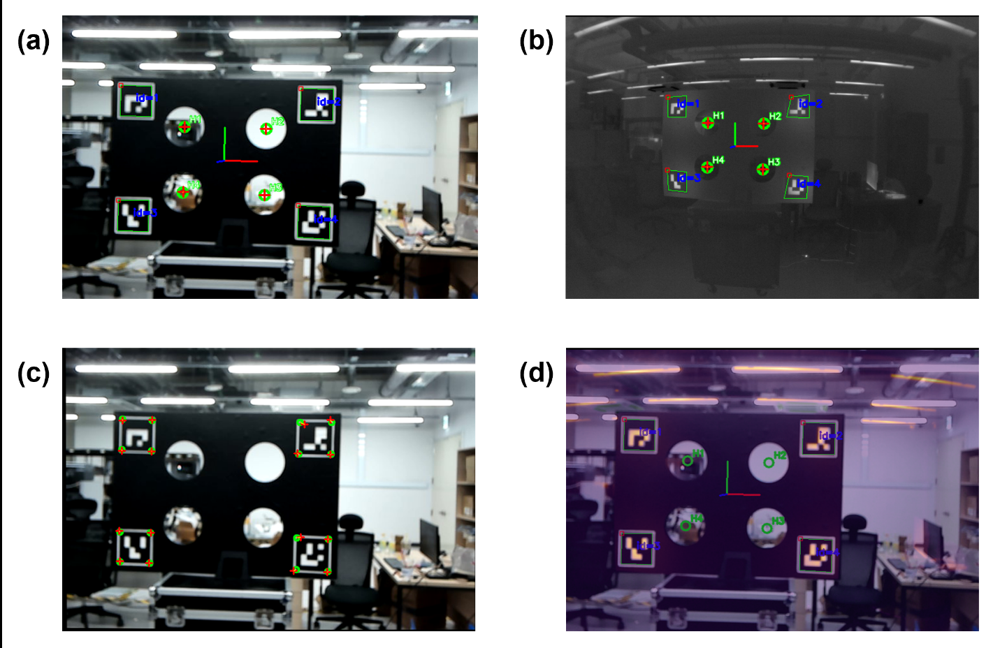
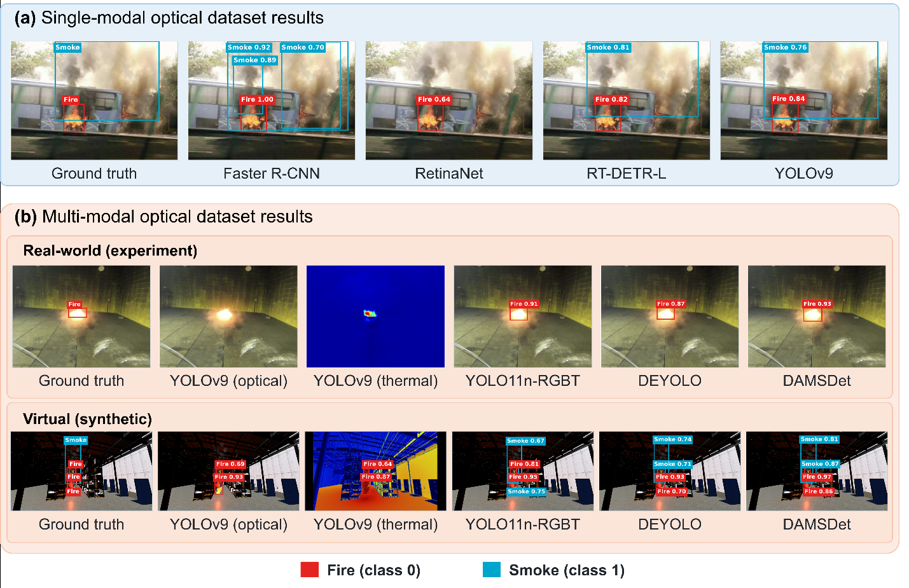

# Manuscript v2 Figures

Figures 1-10 below are extracted from the author-supplied v2 manuscript reviewed
on 13 November 2026. The original embedded TIFFs were converted to lossless PNG
at their original dimensions. Decoded RGB pixels were checked for exact equality;
no image was cropped, resized, enhanced, reannotated or regenerated.

The [figure manifest](figure_manifest.json) records the manuscript hash, original
embedded-media hashes, PNG hashes, dimensions and original caption text. It
contains no private local filesystem paths. Captions below clarify usage without
altering the supplied figures. A diagram is not proof of public release, complete
annotation review, independent scenes or a measured fusion advantage.

| Manuscript figure | Subject | PNG |
|---|---|---|
| 1 | Dataset construction workflow | [Figure 1](Figure01.png) |
| 2 | FireGuard hardware and acquisition environments | [Figure 2](Figure02.png) |
| 3 | Curation and four-stage deduplication | [Figure 3](Figure03.png) |
| 4 | Sensor calibration and spatial registration workflow | [Figure 4](Figure04.png) |
| 5 | Semi-supervised annotation and expert-review workflow | [Figure 5](Figure05.png) |
| 6 | Principal extracted directory structures | [Figure 6](Figure06.png) |
| 7 | Representative images and annotations | [Figure 7](Figure07.png) |
| 8 | Normalized Fire/Smoke bounding-box dimensions | [Figure 8](Figure08.png) |
| 9 | Calibration-target and registration observations | [Figure 9](Figure09.png) |
| 10 | Selected held-out detection examples | [Figure 10](Figure10.png) |

## Figure 1 Dataset Construction

Public optical source integration and real/synthetic paired acquisition feed
curation, geometric registration, annotation and packaging. LiDAR is an
intermediate calibration reference, not a released data modality. The two records
remain separate datasets with different sample membership.

## Figure 2 Acquisition Setup

The manuscript describes optical, thermal and LiDAR acquisition at nominal rates
of 30, 10 and 10 fps. Synthetic scenes comprise an underground parking lot, a
logistics warehouse and a reuse-battery storage facility. These illustrations do
not establish exposure-time synchronization or physically calibrated synthetic
temperature measurements.

## Figure 3 Curation

The four stages distinguish binary, decoded-pixel, normalized-exact and
perceptual matching. Optical curation operates on images; paired decisions
require the corresponding optical and thermal comparisons. Schematic examples
do not establish that different acquisition groups are independent scenes.
See the [methods and limitations](../../docs/methods_and_validation.md).

## Figure 4 Spatial Registration

Camera intrinsics and camera-LiDAR extrinsics provide geometric correspondence.
The released thermal views are already processed and registered. A static
reference-plane registration can retain parallax at other depths; no LiDAR
point clouds or calibrated per-pixel temperature arrays are included.

## Figure 5 Annotation Workflow

The manuscript describes initial annotation, teacher/student model assistance,
review and iterative label updates. The drawing is a workflow illustration,
not a quantitative audit of review coverage or annotation accuracy. Synthetic
annotations have model-assisted provenance; the released labels should not be
treated as wholly independent, manually drawn ground truth.

## Figure 6 Directory Structure

**Important naming difference:** this supplied figure labels the optical root
`public_optical/`. The actual frozen archive root is `public optical/`, including
the space. The paired root is `paired_RGBT/`. Use the actual paths in the
[structure guide](../../docs/DATASET_STRUCTURE_AND_METADATA.md), manifests and
archive catalogs. The overview omits auxiliary files such as `PAYLOAD_FILES.csv`;
omission from the drawing does not mean that a file is absent from the release.

The earlier editable diagram is retained as a
[historical source](../directory_structure/Figure6_Editable_Directory_Structure_20261109.pptx),
not as an editable version of this new figure.

## Figure 7 Representative Annotations

Single-modal examples include Fire, Smoke, both classes and an empty label.
Paired examples illustrate the real and synthetic domains. These are annotation
examples, not a claim that every example belongs to held-out test. In particular,
the real paired test split has no Smoke ground-truth annotations. Source
rectangles and frozen canonical training labels are distinct annotation layers.

## Figure 8 Bounding-Box Dimensions

Widths and heights are percentages of image dimensions; colour denotes the
number of boxes per bin on a logarithmic scale. Optical counts are Fire 67,269
and Smoke 45,010. Paired counts are Fire 49,361 and Smoke 32,363, counted once per
pair. The paired panels depict original source rectangles, not the clipped
canonical training targets. All frozen splits contribute to these descriptive
statistics. Underlying bins and definitions remain in the
[reproducible statistics](../data_overview/README.md).

## Figure 9 Calibration Observations

Optical and thermal target features, marker-corner correspondences and an
overlay illustrate spatial registration. This figure is not a temporal alignment
measurement or proof of uniformly accurate registration at every depth.

## Figure 10 Held-Out Detection Examples

Public optical models share the same test image. Paired comparisons share the
same real or synthetic pair, with fusion predictions displayed on the optical
view and thermal-only predictions on the registered thermal view. The supplied
panel (b) heading abbreviates the paired record as "multi-modal optical"; the
actual model inputs and dataset are optical-thermal.

These are purposively selected examples, not a random or statistically
representative sample. Display confidence is at least 0.50. The paired examples
illustrate real Fire and synthetic Smoke objects missed by both single-modality
models but matched by fusion models at class-correct IoU at least 0.50. They do
not establish a general or capacity-matched causal fusion advantage. Negative
examples are omitted from the illustration only, not from the original test
metrics. Full-test values and their distinct native P/R conventions are given
in the [benchmark notes](../../docs/benchmarks.md).
